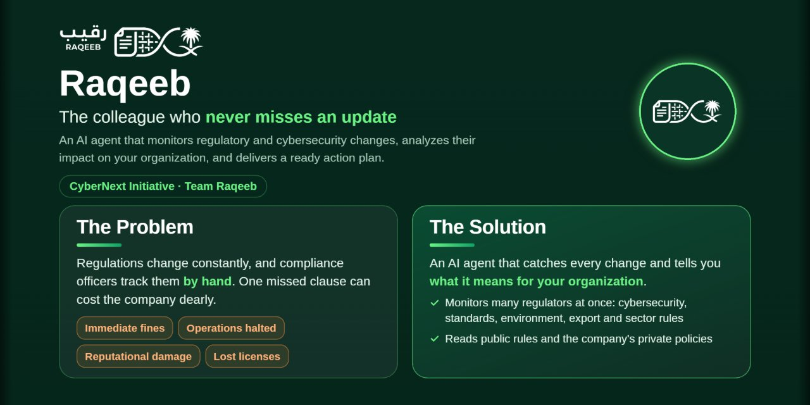

  

# RAQEEB | AI-Powered Regulatory Intelligence & Compliance

**Transforming regulatory changes into actionable compliance insights.**

RAQEEB is an AI-powered regulatory intelligence and compliance platform designed to help organizations monitor regulatory developments, understand their potential business impact, and manage compliance-related changes through structured, evidence-based analysis.

By combining automated regulatory monitoring, AI-driven analysis, and organization-specific impact assessment, RAQEEB aims to simplify how organizations stay informed and respond to evolving regulatory requirements.

**Live Prototype:** [Explore RAQEEB](https://rana-aljarboua.github.io/RAQEEB-Prototype/)

**Project Presentation:** [View RAQEEB Presentation](https://rana-aljarboua.github.io/RAQEEB-Prototype/Raqeeb%20Presentation.pdf)

---

## Why RAQEEB?

Regulatory requirements evolve continuously, making it challenging for organizations to identify relevant updates, understand their implications, and determine the actions required to maintain compliance.

RAQEEB addresses this challenge by connecting regulatory intelligence with organizational context.

Key objectives include:

- **Regulatory Awareness:** Monitor updates from relevant regulatory authorities.
- **Intelligent Analysis:** Extract regulatory information and identify meaningful changes.
- **Impact Assessment:** Evaluate potential implications based on organizational activities and compliance requirements.
- **Evidence-Based Insights:** Link analytical findings to their supporting regulatory sources.
- **Actionable Recommendations:** Help compliance professionals understand changes and identify appropriate follow-up actions.

## How It Works

RAQEEB follows a structured regulatory intelligence workflow:

1. **Regulatory Monitoring** – Collect updates from relevant regulatory sources.
2. **Information Extraction** – Identify regulatory content, requirements, and relevant information.
3. **Change Analysis** – Compare regulatory versions and identify changes.
4. **AI-Powered Assessment** – Analyze regulatory changes in context.
5. **Impact Identification** – Connect relevant changes to organizational activities and compliance requirements.
6. **Insights & Alerts** – Present findings, supporting evidence, and recommendations for review.

## Core Capabilities

| Capability | Description |
|---|---|
| Regulatory Monitoring | Collect regulatory publications and updates from relevant authorities. |
| AI-Powered Analysis | Analyze regulatory content and extract structured information. |
| Change Detection | Identify differences between regulatory versions and updates. |
| Impact Assessment | Evaluate potential implications based on organizational context. |
| Effective-Date Analysis | Identify effective dates supported by regulatory evidence. |
| Recommendations & Alerts | Present validated recommendations and track regulatory change alerts. |
| Notifications | Support notification workflows through email and Slack. |
| Scheduled Processing | Automate recurring monitoring and assessment workflows. |
| Evidence-Based Decision Support | Connect findings to authoritative regulatory publications. |

## Regulatory Coverage

RAQEEB includes dedicated connectors for selected Saudi regulatory sources:

- **National Cybersecurity Authority (NCA)**
- **Saudi Standards, Metrology and Quality Organization (SASO)**
- **Umm Al-Qura Gazette (UQN)**
- **Ministry of Energy**

Its extensible connector architecture is designed to accommodate additional regulatory sources.

## Built for Organizational Context

Regulatory requirements do not affect every organization in the same way.

RAQEEB is designed around configurable organizational profiles that consider:

- Industry and business sector
- Jurisdictions and regulatory scope
- Business activities
- Compliance frameworks
- Products and services
- Internal processes and policies
- Policy requirements

This organizational context helps make regulatory assessments more relevant to the activities and compliance obligations of each organization.

## Technology Stack

RAQEEB combines technologies across artificial intelligence, software engineering, data processing, and regulatory analysis.

| Area | Technologies |
|---|---|
| Programming | Python |
| AI Integration | Anthropic Claude |
| Backend Framework | FastAPI |
| Data Management | SQLAlchemy |
| Regulatory Collection | Asynchronous HTTP and web parsing |
| Data Processing | Structured extraction and analysis |
| Change Analysis | Version comparison and obligation calculations |
| Scheduling | APScheduler |
| Notifications | Email and Slack |
| Testing | Pytest |

## System Architecture

RAQEEB follows an API-first architecture designed to connect regulatory data collection, analysis, organizational context, and compliance workflows.

Its core design brings together:

- Regulatory data collection
- Structured information extraction
- Regulatory change analysis
- AI-assisted impact assessment
- Organizational profile management
- Evidence-linked findings
- Notifications and scheduled workflows

The architecture is designed to support integration with organizational systems and future extensions.

## Evidence-Based Decision Support

Reliable compliance decisions require more than automated analysis.

RAQEEB emphasizes traceability by connecting findings to their supporting regulatory publications. This enables compliance professionals to review the underlying evidence, validate analytical conclusions, and make informed decisions.

The goal is to make regulatory intelligence more transparent, structured, and actionable.

## Live Prototype

The public RAQEEB Prototype provides an interactive introduction to the project's concept and user experience.

**[Launch RAQEEB Prototype →](https://rana-aljarboua.github.io/RAQEEB-Prototype/)**

## Project Presentation

Explore the project presentation for an overview of RAQEEB's vision, approach, capabilities, and development.

**[View Project Presentation (PDF) →](https://rana-aljarboua.github.io/RAQEEB-Prototype/Raqeeb%20Presentation.pdf)**

## Development & Contributions

RAQEEB was developed collaboratively, bringing together work across artificial intelligence, regulatory analysis, software development, and product design.

The project reflects an effort to explore how AI-powered systems can help organizations understand regulatory changes and manage compliance-related challenges.

---

**RAQEEB — Turning Regulatory Complexity into Actionable Intelligence.**