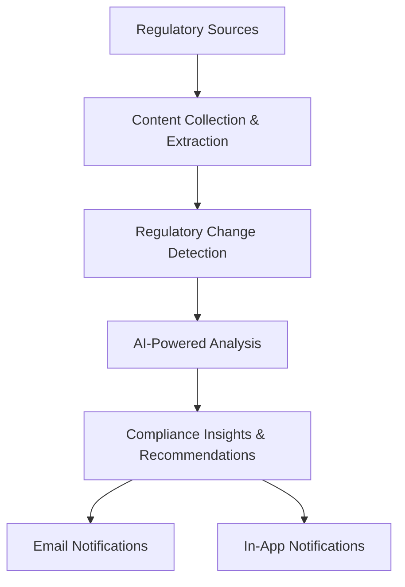

# RAQEEB | AI-Powered Regulatory Intelligence & Compliance

  <strong>Transforming Regulatory Changes into Actionable Compliance Insights.</strong>

  
  
  

---

## Overview

RAQEEB is an AI-powered regulatory intelligence platform designed to help organizations monitor regulatory updates, identify changes, understand their implications, and translate them into structured compliance insights.

Organizations operate in an evolving regulatory environment where keeping track of multiple authorities, interpreting new requirements, and assessing their potential impact can be challenging.

RAQEEB aims to simplify this process by combining artificial intelligence, regulatory analysis, and Governance, Risk, and Compliance (GRC) principles within a unified workflow.

The goal is to move beyond simply collecting regulatory updates — towards understanding what changed, why it matters, and what organizations may need to address.

## The Challenge

Regulatory compliance requires continuous attention to changing requirements. Organizations need to do more than read new publications; they need to identify relevant changes and understand how these changes may affect their operations.

Key challenges include:

- Monitoring updates across multiple regulatory sources.
- Identifying new or modified regulatory requirements.
- Comparing current and previous regulatory versions.
- Extracting effective dates and supporting evidence.
- Understanding potential implications for organizational compliance.
- Turning regulatory information into actionable follow-up.

## How It Works

The platform follows a connected workflow that transforms regulatory publications into organized compliance insights.

### Workflow Stages

| Stage | Description |
|---|---|
| Regulatory Monitoring | Collecting updates from relevant regulatory sources. |
| Content Extraction | Extracting information from regulatory publications and documents. |
| Change Detection | Comparing regulatory versions to identify new or modified content. |
| AI-Powered Analysis | Analyzing regulatory information and organizing relevant findings. |
| Compliance Insights | Presenting requirements, effective dates, and potential implications. |
| Notifications | Delivering updates through email and in-app notifications. |

## Core Capabilities

| Capability | Value |
|---|---|
| **Regulatory Monitoring** | Supports continuous tracking of regulatory developments. |
| **Change Detection** | Highlights differences between regulatory versions. |
| **Effective-Date Analysis** | Identifies effective dates supported by regulatory evidence. |
| **Compliance Impact Analysis** | Helps assess the implications of regulatory changes. |
| **Recommendations & Alerts** | Supports awareness and follow-up on relevant changes. |
| **Evidence-Based Insights** | Connects findings to supporting regulatory sources. |

## Regulatory Coverage

RAQEEB is designed to monitor Saudi regulatory sources, including:

- **NCA** — National Cybersecurity Authority.
- **SASO** — Saudi Standards, Metrology and Quality Organization.
- **Umm Al-Qura** — Saudi Arabia's Official Gazette.
- **Ministry of Energy** — Regulatory publications and updates.

The connector-based approach is designed to accommodate additional regulatory sources as the platform evolves.

## Organizational Context

Regulatory requirements do not affect every organization in the same way. Their relevance depends on the organization's industry, activities, operations, and applicable frameworks.

RAQEEB incorporates organizational context to support more relevant regulatory analysis, considering:

- Industry sectors and business activities.
- Regulatory jurisdictions and applicable frameworks.
- Products and operational processes.
- Internal policies and compliance requirements.

## Technology Stack

| Area | Technologies |
|---|---|
| Programming Language | Python |
| Backend Framework | FastAPI |
| Database & ORM | SQLite, SQLAlchemy |
| AI Integration | Anthropic Claude, Structured Tool Use |
| Data Extraction | Web Content Processing, PDF Extraction |
| Scheduling | APScheduler |
| Notifications | Email, In-App Notifications |
| Testing | Pytest |

*The technologies above describe the broader RAQEEB project. This public repository showcases the frontend prototype and presentation, not the private backend implementation.*

## Evidence-Based Decision Support

A central principle of RAQEEB is that regulatory insights should be traceable to their supporting sources.

The platform emphasizes connecting identified changes, extracted requirements, and effective dates to relevant regulatory evidence. This supports transparency, review, and a clearer understanding of the regulatory basis behind analytical findings.

## My Role & Contributions

I contributed to RAQEEB across three interconnected areas:

### AI Developer
- Contributed to the development of the AI Agent's logic and analytical workflow.
- Worked on regulatory information analysis and the organization of structured outputs.
- Contributed to processing logic that transforms regulatory information into useful insights.

### GRC Analyst
- Analyzed regulatory information and compliance requirements.
- Examined regulatory changes and their potential implications for organizational compliance.
- Contributed to connecting regulatory analysis with organizational requirements.

### Frontend Development
- Collaborated with the team on developing the user interface.
- Contributed to presenting platform capabilities and analytical outputs through a clear user experience.

## Live Prototype

Explore the public-facing RAQEEB prototype:

[**Launch RAQEEB Prototype →**](https://rana-aljarboua.github.io/RAQEEB-Prototype/)

## Project Presentation

Explore the project concept, objectives, and overall approach:

[**View Project Presentation (PDF) →**](./Raqeeb%20Presentation.pdf)

## Repository Scope

This public repository serves as a portfolio showcase for the RAQEEB frontend prototype and project presentation.

It is separate from the original private project repository and does not include the private backend, database, or internal source code.

---

  <strong>RAQEEB</strong> 
  Bridging Artificial Intelligence, Regulatory Intelligence, and Compliance.

